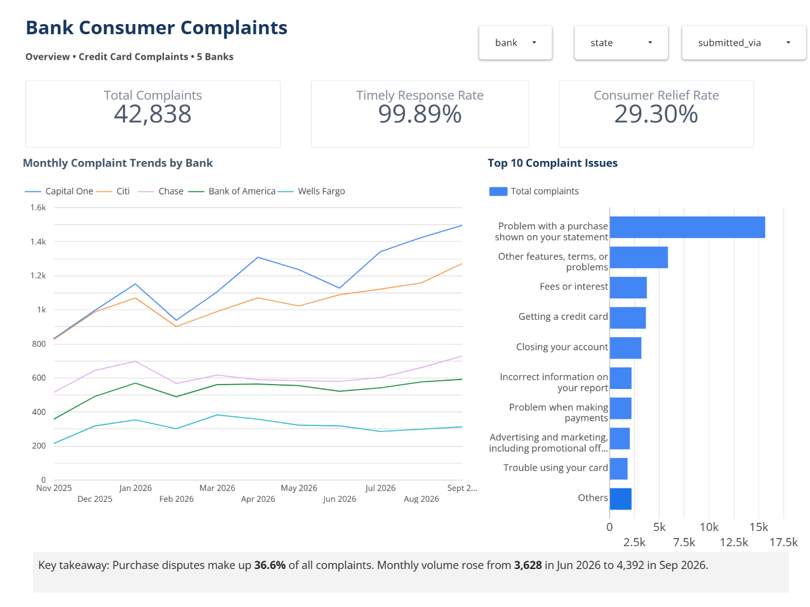
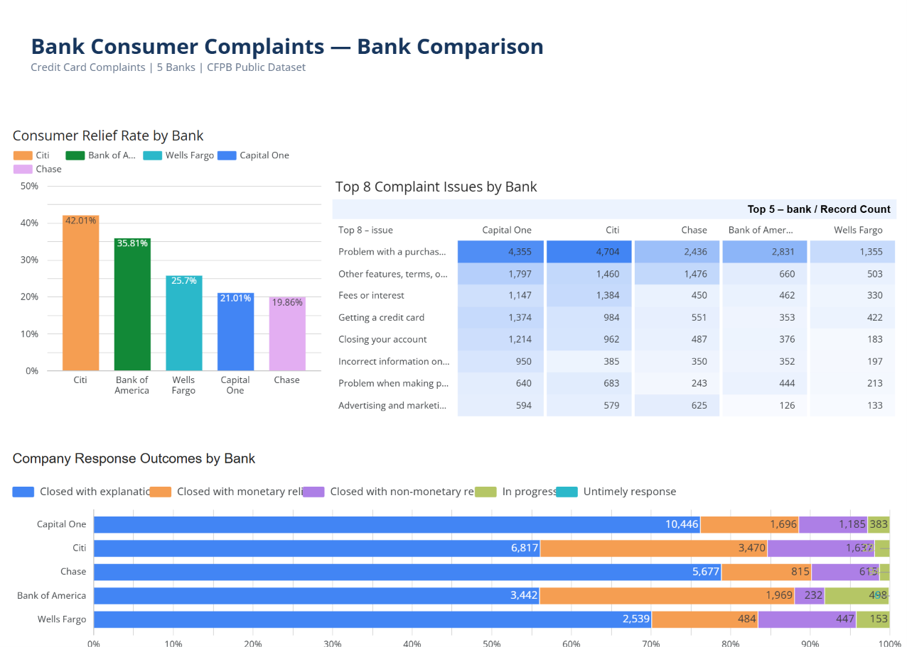
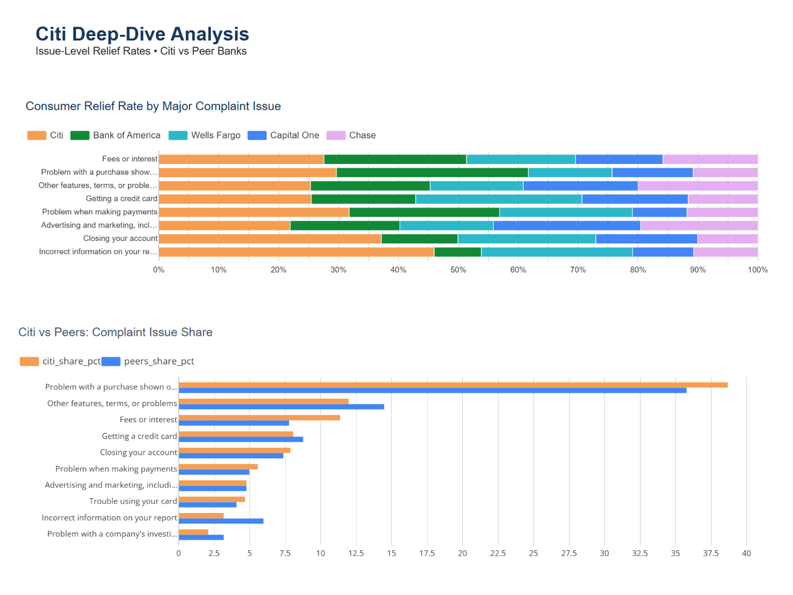
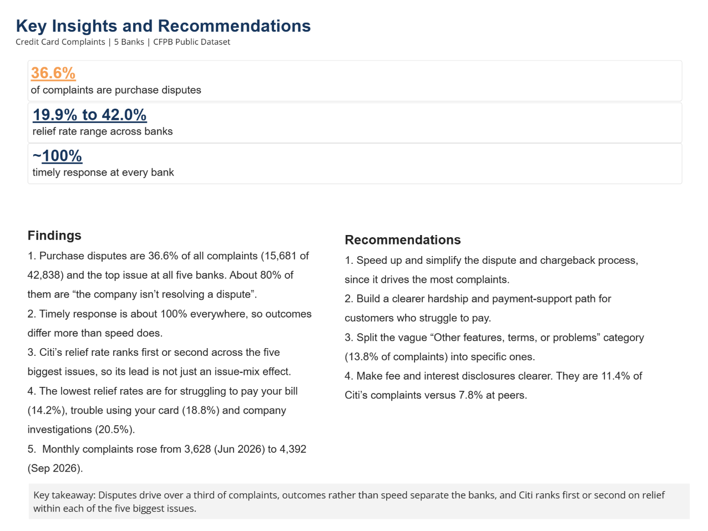

# Bank Credit Card Complaints Analysis (CFPB)

Analysis of 42,838 credit card complaints against five large US banks, using SQL, Python and an interactive dashboard. It looks at what customers complain about, how outcomes differ by bank, and what a bank should fix first.

**[Open the Looker Studio dashboard](https://datastudio.google.com/reporting/65eeb341-1ac1-40de-9865-d41a21e0e272)** | **[Open the notebook](cfpb_complaints_analysis.ipynb)**

## Problem
Where are customers having the most trouble with credit cards, how do complaint outcomes differ across banks, and which issues should a bank fix first?

## Dataset
CFPB Consumer Complaint Database (consumerfinance.gov), downloaded 27 Oct 2026.

- Product: Credit card
- Companies: Citibank, N.A.; JPMorgan Chase & Co.; Bank of America, National Association; Wells Fargo & Company; Capital One Financial Corporation
- Date received: 27 Oct 2025 to 27 Oct 2026
- Size: 42,838 complaints, 15 columns
- This export has no complaint narrative and no "consumer disputed" column, so the analysis covers volume, issues, channels, states and company outcomes.

## Tools
Python (pandas, seaborn, matplotlib), SQL (SQLite), Google Colab, Looker Studio, Excel (automated report).

## Approach
1. Loaded the CSV in Google Colab and stored a raw table and a clean table in SQLite.
2. Cleaned the data: standardised column names, trimmed text, removed duplicates on Complaint ID, converted dates, shortened bank names, and filled missing values with labels instead of dropping rows.
3. Created fields: `month`, `days_to_company`, `timely_flag` and `relief_flag`.
4. Analysed with SQL: GROUP BY/HAVING, CASE WHEN, CTEs, and window functions (RANK, LAG).
5. Built a 4-page Looker Studio dashboard.
6. Wrote a reusable Python pipeline that cleans a new export and produces an Excel report.

**Relief rate** is my own metric: the share of complaints the company closed with monetary or non-monetary relief.

## Data quality
- Rows: 42,838 before cleaning and 42,838 after. No duplicate Complaint IDs were found.
- Missing values, kept and labelled rather than dropped:
  - Company public response: 21,897 (labelled "Not provided")
  - Tags: 35,742 (labelled "None", since tags only apply to Older American and Servicemember complaints)
  - State: 245 and ZIP code: 180 (labelled "Unknown")
  - Sub-issue: 38 (labelled "Not specified")
- Partial months: Oct 2025 and Oct 2026 are incomplete because of the date filter, so trend analysis uses Nov 2025 to Sep 2026 only.
- Timely flag check: 42,790 complaints are flagged timely and 48 are not (99.89% timely). Only 6 of the 48 carry the "Untimely response" outcome. The other 42 were closed with an explanation (23), monetary relief (18) or non-monetary relief (1). I kept the company-reported flag as given.

## Key findings

**1. One issue dominates.** "Problem with a purchase shown on your statement" is 15,681 of 42,838 complaints (36.6%) and the top issue at all five banks. About 80% of these are "the company isn't resolving a dispute".

| Top issues | Complaints | Share | Relief rate |
|---|---|---|---|
| Problem with a purchase shown on your statement | 15,681 | 36.6% | 32.2% |
| Other features, terms, or problems | 5,896 | 13.8% | 31.7% |
| Fees or interest | 3,773 | 8.8% | 35.3% |
| Getting a credit card | 3,684 | 8.6% | 30.2% |
| Closing your account | 3,222 | 7.5% | 22.3% |

**2. Timely response doesn't separate the banks. Outcomes do.**

| Bank | Complaints | Share | Timely | Relief |
|---|---|---|---|---|
| Capital One | 13,710 | 32.0% | 100.0% | 21.0% |
| Citi | 12,157 | 28.4% | 100.0% | 42.0% |
| Chase | 7,201 | 16.8% | 100.0% | 19.9% |
| Bank of America | 6,147 | 14.3% | 99.3% | 35.8% |
| Wells Fargo | 3,623 | 8.5% | 100.0% | 25.7% |

**3. Citi's relief rate ranks first or second across the five biggest issues**, so its overall lead is not just an effect of its issue mix.

| Relief rate by issue | Citi | Bank of America | Wells Fargo | Capital One | Chase |
|---|---|---|---|---|---|
| Purchase problem | 44.8% | 48.4% | 21.1% | 20.4% | 16.3% |
| Fees or interest | 46.4% | 40.0% | 30.6% | 24.6% | 26.7% |
| Closing your account | 37.9% | 13.0% | 23.5% | 17.4% | 10.3% |
| Getting a credit card | 38.4% | 26.3% | 41.9% | 26.8% | 17.6% |
| Other features, terms, or problems | 38.8% | 30.6% | 23.9% | 29.4% | 30.7% |

**4. The mix of company responses differs.** Citi and Bank of America close about 56% of complaints with an explanation only. The other three banks are at 70-79%. Monetary relief is 28.5% at Citi and 32.0% at Bank of America, versus 11-13% at the other three.

| Response | Capital One | Citi | Chase | Bank of America | Wells Fargo |
|---|---|---|---|---|---|
| Closed with explanation | 76.2% | 56.1% | 78.8% | 56.0% | 70.1% |
| Closed with monetary relief | 12.4% | 28.5% | 11.3% | 32.0% | 13.4% |
| Closed with non-monetary relief | 8.6% | 13.5% | 8.5% | 3.8% | 12.3% |
| In progress | 2.8% | 1.9% | 1.3% | 8.1% | 4.2% |

**5. Some issues rarely get relief:** struggling to pay your bill (14.2%, 614 complaints), trouble using your card (18.8%, 1,833) and problems with a company's investigation (20.5%, 1,230).

**6. Citi's complaint mix differs from its peers.** Fees or interest are 11.4% of Citi's complaints versus 7.8% at the other four banks. Incorrect information on a credit report is 3.2% versus 6.0%.

**7. Volume is rising.** Monthly complaints grew from 3,628 (Jun 2026) to 4,392 (Sep 2026), about 21%, using complete months only.

**8. Older Americans and servicemembers are not treated worse on relief.** They account for 7,096 complaints (16.6%), with relief rates of 29.4-31.6% against 29.0% for untagged complaints.

## Recommendations
1. Speed up and simplify the dispute and chargeback process. It drives the most complaints.
2. Build a clearer hardship and payment-support path for customers who struggle to pay, since relief is lowest there.
3. Split the vague "Other features, terms, or problems" category (13.8% of complaints) into specific categories, so the complaints can be acted on.
4. Make fee and interest disclosures clearer, especially at Citi where they are a larger share of complaints.

## Limitations
- These are complaint counts, not complaint rates. Banks have different customer bases, so a higher count does not prove a worse bank.
- "Relief" is my own metric, based on the response category the company assigns.
- Complaints are self-reported, so the data has submission bias.
- Between 1.3% and 8.1% of each bank's complaints were still "In progress", so relief rates are slightly understated, most of all for Bank of America.
- The data shows what happened, not why. For example, it cannot explain why Citi's relief rate is high. That could reflect policy, how responses are categorised, or something else.

## Sample SQL

```sql
-- Top 3 issues inside each bank (window function)
SELECT * FROM (
  SELECT bank, issue, COUNT(*) AS complaints,
         RANK() OVER (PARTITION BY bank ORDER BY COUNT(*) DESC) AS rnk
  FROM complaints_clean
  GROUP BY bank, issue
) WHERE rnk <= 3
ORDER BY bank, rnk;

-- Month-over-month change on complete months (LAG)
WITH m AS (
  SELECT month, COUNT(*) AS complaints
  FROM complaints_clean
  WHERE month BETWEEN '2025-11' AND '2026-09'
  GROUP BY month)
SELECT month, complaints,
       LAG(complaints) OVER (ORDER BY month) AS prev_month,
       ROUND(100.0*(complaints - LAG(complaints) OVER (ORDER BY month))
             / LAG(complaints) OVER (ORDER BY month), 1) AS mom_change_pct
FROM m;
```

## Automation
`run_pipeline(csv_path, out_xlsx)` cleans a fresh CFPB export and writes `weekly_summary.xlsx` with sheets for bank scorecard, top issues, monthly trend and issue by bank. A newer export with the same filters can be run through it in one step.

## Dashboard
[Open the Looker Studio dashboard](https://datastudio.google.com/reporting/65eeb341-1ac1-40de-9865-d41a21e0e272)

**Overview:** totals, timely and relief rates, monthly trend, top issues.


**Bank comparison:** relief by bank, issue-by-bank table, company response outcomes.


**Citi deep-dive:** relief by issue and Citi vs peers issue share.


**Insights and recommendations:**


## Repository contents
```
cfpb_complaints_analysis.ipynb   Notebook: cleaning, SQL analysis, charts, pipeline
weekly_summary.xlsx              Output of the automated report
images/                          Dashboard screenshots and charts
README.md
```

## How to run
1. Download a CSV from the CFPB Consumer Complaint Database with the filters above.
2. Create a Google Drive folder called `cfpb-complaints` and save the file as `complaints.csv`.
3. Open the notebook in Google Colab and run all cells (Runtime > Run all). Allow Drive access when asked.
4. The notebook creates the SQLite database, the analysis tables and the Excel report.

## Author
[Sakshi] | [sakshisood678@gmail.com]
